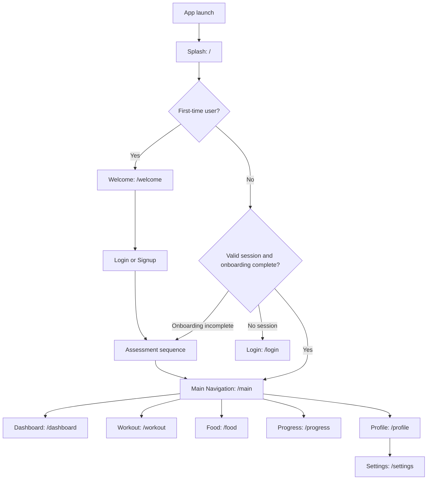
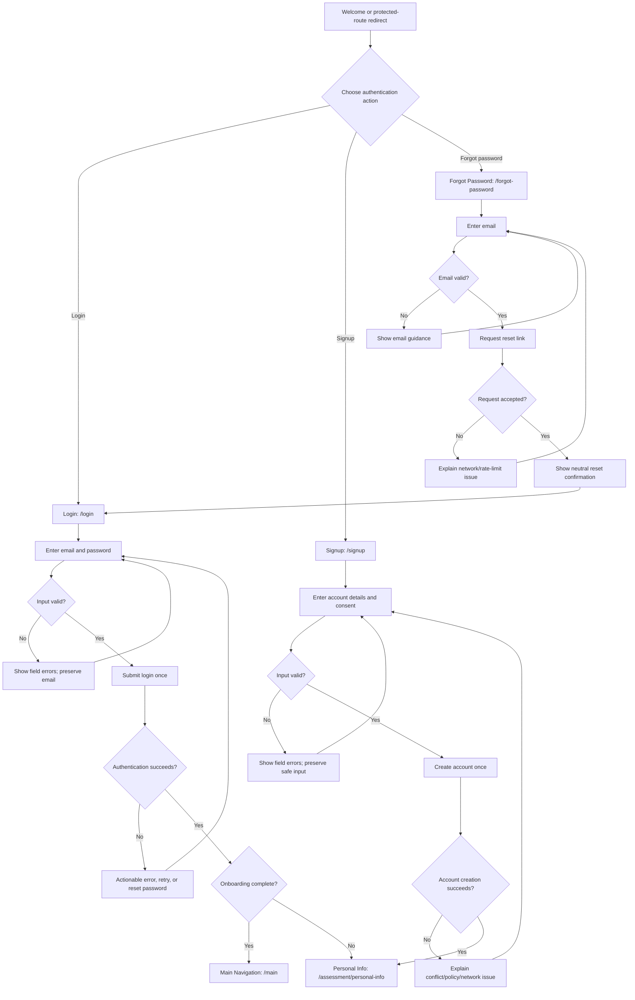
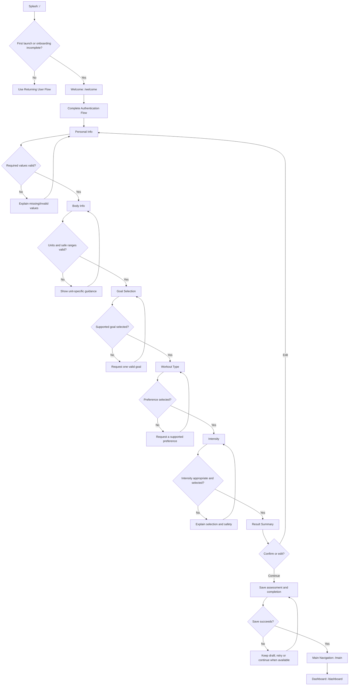
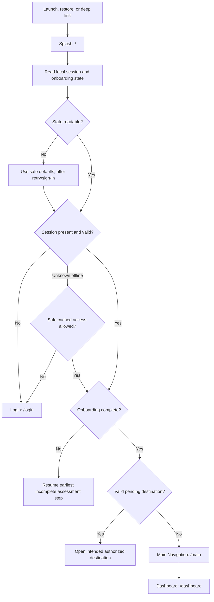
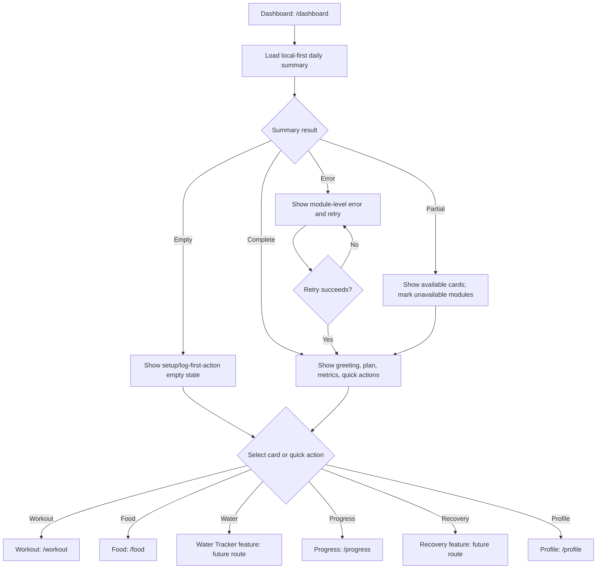
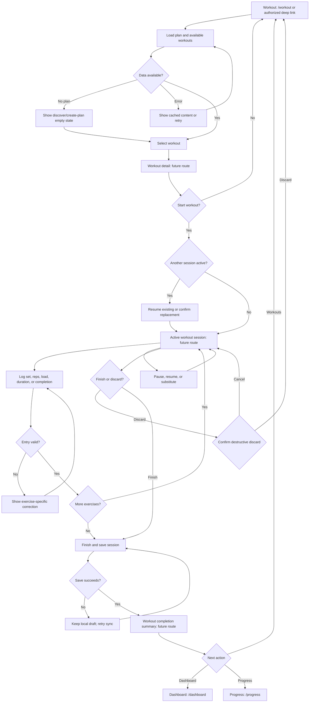
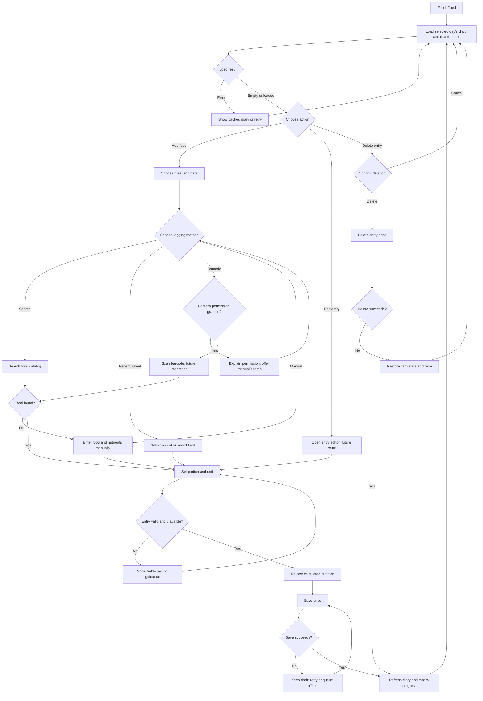
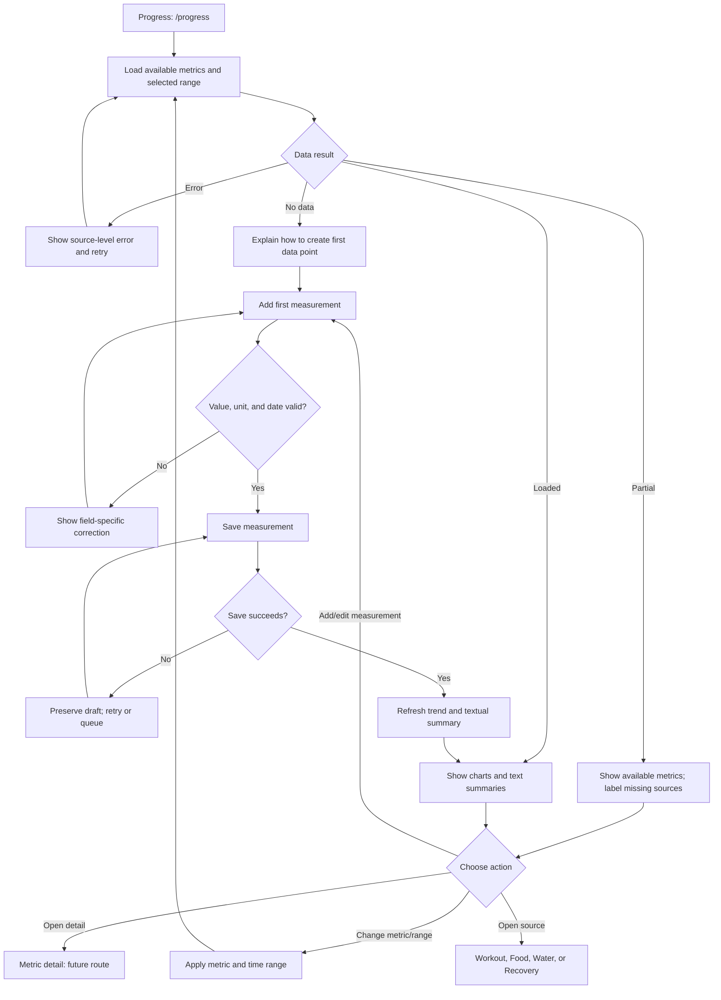
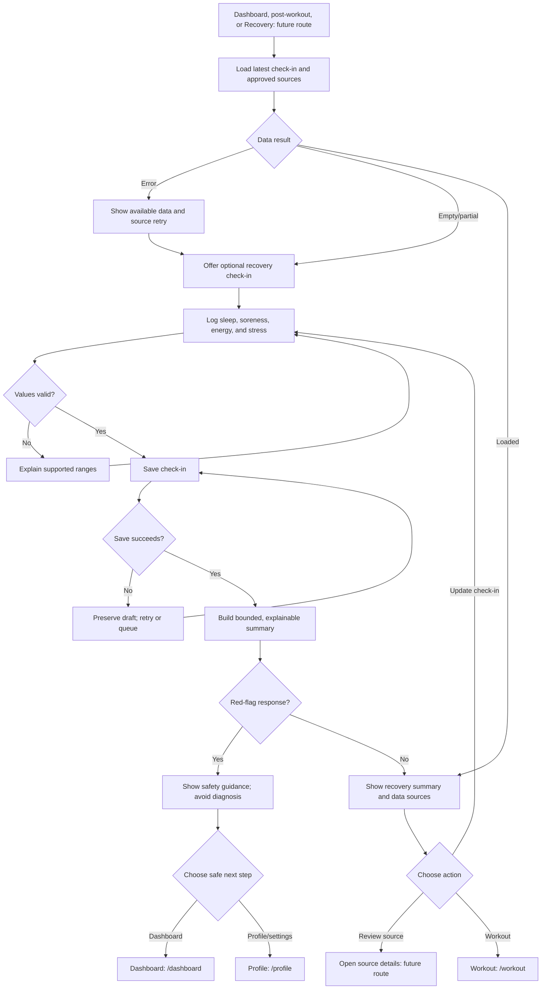

# Fitness App — Complete User Journey

This document defines the intended product flows before screen or business-logic implementation. It complements `PROJECT_CONTEXT.md` and `DESIGN_SYSTEM.md`.

Current registered destinations are shown with their paths. Destinations marked **future route** describe required behavior but are not yet registered. Authentication, persistence, validation, redirects, and integrations are specifications only.

## Journey overview



## 1. Authentication Flow

- **Entry Point:** Welcome, protected-route redirect, expired session, or explicit sign-out.
- **User Action:** Choose Login or Signup; enter credentials; optionally request password reset.
- **Validation:** Required fields, normalized email format, password policy, password confirmation for signup, terms/consent when required, and submission deduplication.
- **Success Path:** Establish a secure session, then resolve onboarding status.
- **Error Path:** Preserve non-sensitive input, show actionable field/global errors, allow retry, and never reveal whether an account exists unnecessarily.
- **Navigation Destination:** New/incomplete user → Personal Info; completed user → Main Navigation; password reset request → confirmation then Login.



### Authentication edge cases

- Offline, timeout, server unavailable, and repeated taps during submission.
- Invalid/expired session, revoked account, unverified email, disabled account, or provider cancellation.
- Existing email during signup, weak/compromised password, reset rate limit, or expired reset link.
- App closed during authentication; resume without exposing passwords or duplicate requests.
- Deep link to a protected route: authenticate first, then return to the safe intended destination.

## 2. First Time User Flow

- **Entry Point:** Splash when no completed local onboarding marker/session exists.
- **User Action:** Review Welcome, create/login to an account, complete assessment steps, review result summary, and continue.
- **Validation:** Each step validates only necessary data; physical measurements use explicit units and safe ranges; users can go back without losing valid entries.
- **Success Path:** Persist completion atomically and open Main Navigation/Dashboard.
- **Error Path:** Keep progress locally, explain invalid/missing input, retry persistence, and resume the earliest incomplete step.
- **Navigation Destination:** Main Navigation, initially Dashboard.



### First-time-user edge cases

- User changes units, skips optional data, enters impossible values, or changes goals mid-flow.
- Back navigation, app termination, rotation, and process restoration during assessment.
- Account exists but onboarding is partial on another device; choose the newest valid server state after future sync rules exist.
- User declines optional health data; continue with reduced personalization.
- Underage or safety-sensitive responses require approved product/legal handling before launch.

## 3. Returning User Flow

- **Entry Point:** Splash on subsequent launch, notification/deep link, or app restoration.
- **User Action:** Wait for local session/onboarding resolution; unlock if future app-lock is enabled.
- **Validation:** Session validity, onboarding completion, safe deep-link destination, minimum local data integrity, and connectivity only when required.
- **Success Path:** Restore Main Navigation and the appropriate destination/state.
- **Error Path:** Route expired sessions to Login, incomplete onboarding to the correct assessment step, and corrupt/unavailable data to a recoverable state.
- **Navigation Destination:** Intended safe deep link or Main Navigation/Dashboard.



### Returning-user edge cases

- Token expires while offline, device clock changes, account is deleted remotely, or permissions are revoked.
- Deep link points to deleted, unauthorized, malformed, or now-unsupported content.
- App version/schema migration is required before local data can be read.
- Multiple accounts used on one device; never leak cached data between accounts.
- Resume target no longer exists; fall back to the nearest safe parent destination.

## 4. Dashboard Flow

- **Entry Point:** Main Navigation default destination or Dashboard tab.
- **User Action:** Review today's summary, open workout/food/water/progress/recovery modules, or perform a quick action.
- **Validation:** Data belongs to the active user and date; stale/missing metrics are labeled; quick actions validate their own input.
- **Success Path:** Display available modules and navigate while preserving dashboard state.
- **Error Path:** Render partial content, module-level retry, cached values with timestamps, and a useful empty state for no plan/data.
- **Navigation Destination:** Workout, Food, Water Tracker, Progress, Recovery, Profile, or future detail route.



### Dashboard edge cases

- New day/timezone change, delayed sync, duplicated records, or stale wearable metrics.
- No active workout plan, no logs today, partial permissions, or one module unavailable.
- Large text/long names and reordered cards must not break navigation or hide essential states.
- Quick action submitted twice; operations must be idempotent or guarded.

## 5. Workout Flow

- **Entry Point:** Workout tab, Dashboard workout card, plan notification, or authorized deep link.
- **User Action:** Select a workout, inspect details, start, record sets/reps/load/time, pause/resume, substitute exercises, and finish or discard.
- **Validation:** Workout availability, safe numeric ranges, required completion data, active-session uniqueness, and confirmation before destructive discard.
- **Success Path:** Save an idempotent workout session, update progress/recovery inputs, and show a completion summary.
- **Error Path:** Keep an offline/local session draft, retry sync, recover interrupted sessions, and surface invalid entries next to their exercise.
- **Navigation Destination:** Workout completion summary (**future route**), Progress, Dashboard, or Workout list.



### Workout edge cases

- App killed, call interruption, screen lock, low battery, or crash during an active session.
- Offline start/finish, sync conflict, duplicated completion, or session active on another device.
- Exercise removed from plan, equipment unavailable, substitution incompatible, or timer crosses midnight.
- Zero/negative/extreme values, unit changes, skipped sets, partial workout, or accidental discard.
- Safety warning or pain report must not be overridden by motivational copy.

## 6. Food Logging Flow

- **Entry Point:** Food tab, Dashboard food card/quick action, or meal reminder.
- **User Action:** Select meal, search food, scan barcode in future, choose saved/recent item, set portion/unit, review nutrients, and save/edit/delete.
- **Validation:** Food identity, positive portion, supported unit/conversion, plausible nutrient values, date/meal ownership, and required permission for scanning.
- **Success Path:** Save one idempotent food entry and refresh daily calories/macros.
- **Error Path:** Preserve the draft, allow manual entry when search/scan fails, retry sync, and confirm destructive deletion.
- **Navigation Destination:** Food diary, entry detail/edit (**future route**), or Dashboard.



### Food-logging edge cases

- No search result, incorrect barcode, duplicate catalog foods, unavailable nutrition, or unsupported serving unit.
- Decimal/localized input, unit conversion, recipe/multi-serving item, previous-day logging, and timezone changes.
- Camera denied permanently or unavailable; manual/search path must remain available.
- Offline catalog, queued duplicate save, concurrent edit, or deleted remote entry.
- Do not moralize foods or use warning/error colors merely for exceeding a target.

## 7. Water Tracking Flow

- **Entry Point:** Dashboard water card/quick action, future Water Tracker destination, or reminder.
- **User Action:** Add a preset/custom amount, change unit, edit/delete an entry, and adjust a daily target.
- **Validation:** Positive plausible amount, supported unit conversion, target above zero, active user/date, and duplicate-submission guard.
- **Success Path:** Save the entry, update daily progress, and acknowledge target completion once without celebration spam.
- **Error Path:** Preserve amount, queue offline if supported, retry, and roll back optimistic UI when persistence fails.
- **Navigation Destination:** Water Tracker (**future route**) or Dashboard.

```mermaid
flowchart TD
    Entry["Dashboard quick action or Water Tracker: future route"] --> Load["Load today's target and entries"]
    Load --> Result{"Load result"}
    Result -- "Error" --> LoadError["Show cached state or retry"]
    LoadError --> Load
    Result -- "Loaded/empty" --> Action{"Choose action"}
    Action -->|"Quick add"| Preset["Select preset amount"]
    Action -->|"Custom add"| Custom["Enter amount and unit"]
    Action -->|"Edit"| Edit["Edit selected entry"]
    Action -->|"Delete"| ConfirmDelete{"Confirm deletion"]
    Action -->|"Set target"| Target["Enter daily target"]
    Preset --> Validate{"Amount/target valid?"}
    Custom --> Validate
    Edit --> Validate
    Target --> Validate
    Validate -- "No" --> ValidationError["Explain valid range and unit"]
    ValidationError --> Action
    Validate -- "Yes" --> Save["Persist once; update optimistically if safe"]
    Save --> Saved{"Save succeeds?"}
    Saved -- "No" --> Rollback["Rollback or mark pending; allow retry"]
    Rollback --> Action
    Saved -- "Yes" --> Progress["Refresh daily progress"]
    ConfirmDelete -- "Cancel" --> Action
    ConfirmDelete -- "Delete" --> Delete["Delete selected entry"]
    Delete --> Saved
    Progress --> Goal{"Target newly reached?"}
    Goal -- "Yes" --> Success["Show one accessible success acknowledgement"]
    Goal -- "No" --> Destination{"Stay or return"}
    Success --> Destination
    Destination -->|"Stay"| Action
    Destination -->|"Dashboard"| Dashboard["Dashboard: /dashboard"]
```

### Water-tracking edge cases

- Millilitres/ounces conversion and rounding, custom presets, negative/zero/extreme amounts.
- Entry edited across midnight/timezone, duplicated quick tap, or target reduced below consumed amount.
- Offline save conflict or optimistic update failure.
- Target is guidance, not medical advice; do not prescribe unsafe intake.

## 8. Progress Flow

- **Entry Point:** Progress tab, Dashboard metric, workout summary, or authorized deep link.
- **User Action:** Choose metric and time range, inspect trends, add/edit manual measurements, and review milestones.
- **Validation:** Metric/date/unit validity, plausible values, unique record policy, source provenance, and authorization.
- **Success Path:** Show an accessible chart plus textual summary; save measurements and update trends.
- **Error Path:** Show available metrics independently, label stale/insufficient data, preserve drafts, and retry failed sources.
- **Navigation Destination:** Progress root, future metric detail, source module, or Dashboard.



### Progress edge cases

- Too little data for a trend, gaps, outliers, changed units, corrected/deleted source records.
- Multiple sources report the same metric; show provenance and apply documented deduplication.
- Timezone/range boundaries, future-dated input, wearable sync delay, or stale cached charts.
- Charts remain understandable with screen readers, color-vision differences, and large text.
- Avoid medical conclusions or shame-based interpretation of weight/body metrics.

## 9. Recovery Flow

- **Entry Point:** Dashboard recovery card, post-workout prompt, reminder, or future Recovery destination.
- **User Action:** Log sleep, soreness, energy, stress, rest-day activity, or review a recovery summary.
- **Validation:** Supported ranges, valid date, source/provenance, duplicate policy, and clear optionality for sensitive inputs.
- **Success Path:** Save check-in and present a bounded, explainable recovery summary.
- **Error Path:** Preserve check-in, allow partial data, retry unavailable sources, and avoid unsafe recommendations.
- **Navigation Destination:** Recovery (**future route**), Dashboard, Workout, or Profile permissions/settings.



### Recovery edge cases

- Missing wearable permission/data, poor-quality sleep data, conflicting manual and wearable records.
- User skips sensitive questions or logs after midnight; optional data must not block app use.
- Severe pain, fainting, chest pain, or crisis content requires approved safety escalation—not an AI-generated diagnosis.
- Recovery score uncertainty must be visible; never present consumer sensor estimates as clinical truth.

## 10. Profile Flow

- **Entry Point:** Profile tab, avatar/account action, or protected account deep link.
- **User Action:** Review/edit personal data, goals, preferences, units, privacy/permissions, settings, sign out, export, or request deletion in future.
- **Validation:** Field formats/ranges, re-authentication for sensitive actions, unique account constraints, consent, and unsaved-change handling.
- **Success Path:** Save updates atomically, refresh dependent presentation, and confirm changes.
- **Error Path:** Preserve edits, show field/global errors, roll back failed optimistic changes, and require explicit confirmation for destructive actions.
- **Navigation Destination:** Profile, Settings, relevant assessment edit step, Login after sign-out, or future privacy/account routes.

```mermaid
flowchart TD
    Entry["Profile: /profile"] --> Load["Load account, preferences, and privacy summary"]
    Load --> Result{"Load succeeds?"}
    Result -- "No" --> Error["Show cached safe data or retry"]
    Error --> Load
    Result -- "Yes" --> Profile["Show profile options"]
    Profile --> Action{"Choose action"}
    Action -->|"Edit personal/body info"| Assessment["Relevant assessment edit step"]
    Action -->|"Edit goals/preferences"| Preferences["Goal/preferences editor: future route"]
    Action -->|"Settings"| Settings["Settings: /settings"]
    Action -->|"Privacy/permissions"| Privacy["Privacy and permissions: future route"]
    Action -->|"Export data"| Export["Request export: future backend flow"]
    Action -->|"Sign out"| SignOutConfirm{"Confirm sign out"]
    Action -->|"Delete account"| Reauth["Re-authenticate and explain consequences"]
    Assessment --> Validate{"Changes valid?"}
    Preferences --> Validate
    Settings --> Validate
    Privacy --> Validate
    Validate -- "No" --> ValidationError["Show correction and preserve changes"]
    ValidationError --> Profile
    Validate -- "Yes" --> Save["Save changes atomically"]
    Save --> Saved{"Save succeeds?"}
    Saved -- "No" --> SaveError["Preserve draft; rollback and retry"]
    SaveError --> Profile
    Saved -- "Yes" --> Success["Confirm and refresh dependent data"]
    Success --> Profile
    Export --> ExportResult{"Request accepted?"}
    ExportResult -- "No" --> ExportError["Explain failure and retry"]
    ExportResult -- "Yes" --> ExportConfirm["Confirm secure delivery process"]
    ExportError --> Profile
    ExportConfirm --> Profile
    SignOutConfirm -- "Cancel" --> Profile
    SignOutConfirm -- "Sign out" --> Clear["Clear session and account-scoped cache"]
    Clear --> Login["Login: /login"]
    Reauth --> ReauthResult{"Identity verified?"}
    ReauthResult -- "No" --> ReauthError["Cancel safely or retry"]
    ReauthError --> Profile
    ReauthResult -- "Yes" --> DeleteConfirm{"Final explicit deletion confirmation"}
    DeleteConfirm -- "Cancel" --> Profile
    DeleteConfirm -- "Delete" --> Delete["Submit deletion once; future backend flow"]
    Delete --> Login
```

### Profile edge cases

- Unsaved changes on back navigation, session expiry during save, account conflict, or concurrent edit on another device.
- Unit changes require presentation conversion without silently rewriting historical source measurements.
- Sign-out while offline must clear sensitive local access safely and reconcile server revocation later.
- Export/delete requests require identity verification, clear status, retry safety, and policy-compliant retention.
- Permission revocation must explain degraded features without coercion.

## Cross-flow edge-case rules

- **Offline:** Preserve safe local work, label pending/stale state, and retry idempotently when connectivity returns.
- **Duplicate actions:** Disable repeated submission and use idempotency at future persistence boundaries.
- **Session expiry:** Preserve non-sensitive drafts, authenticate, then resume the authorized intended action.
- **Partial failure:** Keep successful modules usable; avoid replacing the entire destination with one global error.
- **Deep links:** Validate syntax, authentication, authorization, resource existence, and a safe fallback destination.
- **Back navigation:** Confirm only when data would be lost or an active operation would be abandoned.
- **App interruption:** Restore the nearest safe state after process death, rotation, update, or device restart.
- **Date/time:** Store timestamps with timezone/offset context and handle midnight, travel, and clock changes.
- **Accessibility:** All flow outcomes must be readable by assistive technology and cannot rely on color or animation alone.
- **Sensitive data:** Minimize collection, obtain consent, isolate account caches, and never log secrets or private health content.
- **Safety:** Fitness, nutrition, recovery, wearable, and future AI guidance must avoid diagnosis and unsafe prescriptions.

## Navigation implementation note

Current routes remain centralized in `lib/app/routes.dart`. Future routes identified here must be added only when their screens are explicitly approved. Redirects, route guards, shell navigation, backend calls, and state management are intentionally not implemented by this document.
